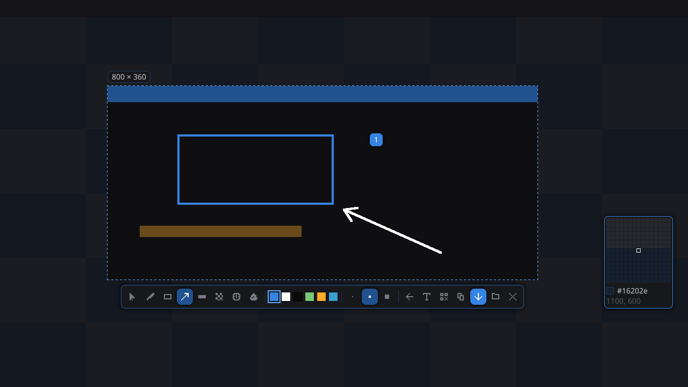
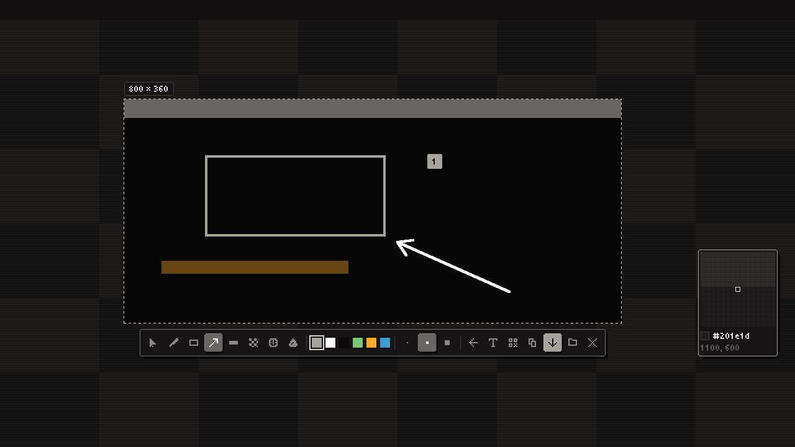

# nemo-shot

English · [Русский](README.ru.md)

A screenshot tool for Wayland: the screen freezes, you select, mark up, copy or save, read the text
or a QR code off it. Works on any compositor with layer-shell and screencopy (niri, Hyprland, Sway,
river, KDE). Part of the [Nemo](https://github.com/HamzaAkramv15/nemo) desktop, and works on its own:
no nemo shell needed.

| neutral look (`plain`) | pixel look (`nemo`) |
|---|---|
|  |  |

## What it does

- An area (with the overlay), the focused window (on niri, taken by niri itself, rounded corners and all) or a whole screen (instant, no overlay), on every monitor at once, HiDPI and fractional
  scales included (1.25 cuts exactly what you selected).
- Marks: pen, frame, arrow, marker, mosaic to hide things, numbered dots, in six colours and three
  widths; undo and redo.
- A colour picker with a loupe: the colour under the cursor as `#rrggbb` into the clipboard.
- Text from the selection (tesseract, English and Russian on the same picture) and QR codes (zbar)
  into the clipboard.
- Copy, save into a folder, or «save as» through nemo-files' dialog (or zenity); a notification with
  a thumbnail and «open» and «folder» buttons.

## Install

**One file** (x86_64, glibc 2.34 or newer) and `grim` and `wl-clipboard` from your distribution:

```sh
curl -LO https://github.com/HamzaAkramv15/nemo/releases/latest/download/nemo-shot
chmod +x nemo-shot
./nemo-shot install
```

No Rust and no root. `install` asks the language and the look, lists what it will change and writes
into `~/.local` only after your yes (`--yes` takes the defaults).

**From source** (Rust 1.89 or newer): `git clone https://github.com/HamzaAkramv15/nemo-shot`, then
`cargo build --release --locked` and `target/release/nemo-shot install`. The drawing library,
nemo-px, comes with the build from the [Nemo](https://github.com/HamzaAkramv15/nemo) repository.

`nemo-shot deps` lists what it uses: grim and wl-clipboard; optional tesseract with the `eng` and
`rus` data (text), zbar (QR), nemo-files or zenity («save as»). `nemo-shot uninstall` takes
everything back.

## Use

Bind it to a key in your compositor, for example in niri:

```kdl
binds {
    Print { spawn "nemo-shot"; }
    Shift+Print { spawn "nemo-shot" "screen"; }
}
```

```sh
nemo-shot [area|window|screen] [--delay SECONDS]   # a second start closes the open overlay
nemo-shot ocr FILE                                 # the text of a picture to stdout
nemo-shot shot -o DIR                              # the overlay as PNG without Wayland
```

| Keys | |
|---|---|
| Space or Enter, Esc | done (copy and save as set below), cancel |
| Tab, W, F | area, window, screen in turn; the window; the screen under the cursor |
| 1 … 8 | select, pen, frame, arrow, marker, mosaic, number, colour picker |
| arrows, Shift+arrows | move the selection by 1 or 10 pixels |
| Ctrl+C | copy the selection; with nothing selected, the colour under the cursor |
| Ctrl+S | save as… |
| Ctrl+Z, Ctrl+Shift+Z or Ctrl+Y | undo, redo |

## Settings

`~/.config/nemo/shot.json`:

| Key | Default | What |
|---|---|---|
| `dir` | empty | where to save; empty: `Pictures/Screenshots` |
| `copy`, `save` | `true`, `true` | what «done» does: into the clipboard, into the folder |
| `confirm` | `space` | `space`: done by Space or Enter; `instant`: as soon as you let go of the mouse |
| `loupe` | `true` | the magnifier next to the cursor |
| `notify` | `true` | a notification with the picture |
| `delay` | `3` | the seconds of the ◷ timer button |
| `prefix` | `nemo` | the start of the file name |

## Look and themes

Without any configuration it takes a neutral look: the system font, rounded corners, soft shadows,
light or dark as your system is set. Every part of it can be changed in two files:

| File | What |
|---|---|
| `~/.config/nemo/style.json` | the look of every nemo program: write a theme once, all of them take it |
| `~/.config/nemo/style.shot.json` | what nemo-shot does differently (only those keys) |

| Key | Values |
|---|---|
| `preset` | `plain` (neutral) or `nemo` (pixel art: whole pixels, notched corners, the Tiny5 font inside the binary) |
| `palette`, `accent` | `blood`, `ash`, `sakura`, `amber`, `venom`, `ice`, `dusk`; or any `#rrggbb`: the rest of the palette is made from it |
| `light` | `true` or `false`; absent: as the system |
| `corners`, `radius` | `notch`, `round` or `square`; the radius in pixels |
| `shadow`, `bevel` | `hard`, `soft` or `none`; a raised edge on buttons |
| `font` | a font family |
| `animations`, `animSpeed` | on or off; their length (0.5 fast, 2 slow) |
| `colors` | any of `bg panel surface surfaceHi codeBg border dim accent deep glow bright selection text textDim textFaint onAccent textHi ok warn` |
| `lang` | `ru`, `en`, `pt-BR`, `es`, `de`, `fr`, `uk`, `pl`; empty: as the system |

The overlay reads them at every start. Inside the nemo desktop the shell writes `style.json` itself
and has a «screenshots» settings tab for `shot.json`.

## License

MIT

Screen recording: press the **record** button in the top bar of the overlay (it records the selected area, or the whole monitor; the same button stops it), or run `nemo-shot record [screen|area] [--audio]`; the shell binds `Shift+Print`. Needs `wf-recorder`; videos go to `~/Videos`.
