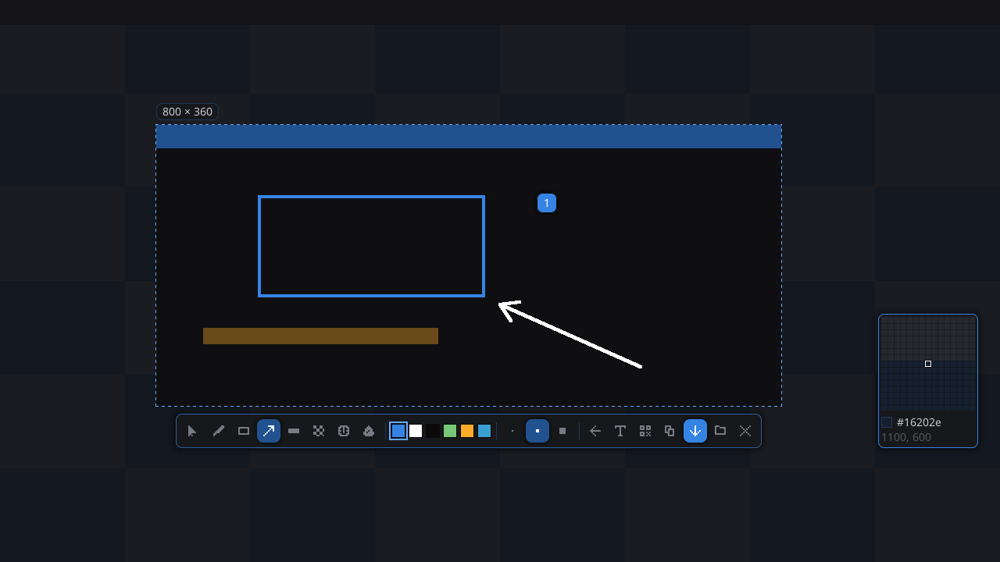
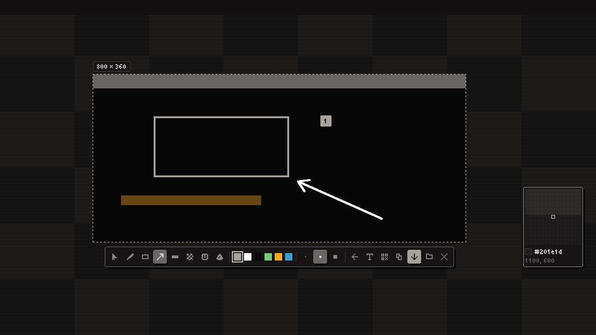

# nemo-shot

[English](README.md) · Русский

Скриншоты для Wayland: экран замирает, ты выделяешь, размечаешь, копируешь или сохраняешь, читаешь
с него текст или QR-код. Работает в любом композиторе с layer-shell и screencopy (niri, Hyprland,
Sway, river, KDE). Часть рабочего стола [Nemo](https://github.com/HamzaAkramv15/nemo), которая работает
и сама по себе: шелл nemo не нужен.

| нейтральный вид (`plain`) | пиксельный вид (`nemo`) |
|---|---|
|  |  |

## Что умеет

- Область, окно (в niri) или весь экран, на всех мониторах сразу, с HiDPI и дробным масштабом
  (при 1.25 вырезается ровно то, что выделено).
- Разметка: перо, рамка, стрелка, маркер, мозаика, чтобы спрятать лишнее, номерки; шесть цветов и
  три толщины; отмена и повтор.
- Пипетка с лупой: цвет под курсором как `#rrggbb` в буфер обмена.
- Текст из выделения (tesseract, английский и русский на одной картинке) и QR-коды (zbar) в буфер
  обмена.
- Скопировать, сохранить в папку или «сохранить как» через диалог nemo-files (или zenity);
  уведомление с миниатюрой и кнопками «открыть» и «папка».

## Установка

**Один файл** (x86_64, glibc 2.34 или новее), а также `grim` и `wl-clipboard` из твоего дистрибутива:

```sh
curl -LO https://github.com/HamzaAkramv15/nemo/releases/latest/download/nemo-shot
chmod +x nemo-shot
./nemo-shot install
```

Без Rust и root. `install` спросит язык и вид, покажет, что изменит, и запишет в `~/.local` только
после твоего «да» (`--yes` берёт ответы по умолчанию).

**Из исходников** (Rust 1.89 или новее): `git clone https://github.com/HamzaAkramv15/nemo-shot`, затем
`cargo build --release --locked` и `target/release/nemo-shot install`. Библиотека рисования nemo-px
приходит при сборке из репозитория [Nemo](https://github.com/HamzaAkramv15/nemo).

`nemo-shot deps` — что берётся из системы: grim и wl-clipboard; по желанию tesseract с данными `eng`
и `rus` (текст), zbar (QR), nemo-files или zenity («сохранить как»). `nemo-shot uninstall` убирает
всё обратно.

## Как пользоваться

Повесь на клавишу в своём композиторе, например в niri:

```kdl
binds {
    Print { spawn "nemo-shot"; }
    Shift+Print { spawn "nemo-shot" "screen"; }
}
```

```sh
nemo-shot [area|window|screen] [--delay СЕКУНДЫ]   # второй запуск закрывает открытый оверлей
nemo-shot ocr ФАЙЛ                                 # текст с картинки в stdout
nemo-shot shot -o ПАПКА                            # оверлей в PNG без Wayland
```

| Клавиши | |
|---|---|
| Space или Enter, Esc | готово (скопировать и сохранить, как настроено ниже), отмена |
| Tab, W, F | область, окно, экран по кругу; окно; экран под курсором |
| 1 … 8 | выделение, перо, рамка, стрелка, маркер, мозаика, номерок, пипетка |
| стрелки, Shift+стрелки | сдвинуть выделение на 1 или 10 пикселей |
| Ctrl+C | скопировать выделение; без выделения — цвет под курсором |
| Ctrl+S | сохранить как… |
| Ctrl+Z, Ctrl+Shift+Z или Ctrl+Y | отменить, повторить |

## Настройки

`~/.config/nemo/shot.json`:

| Ключ | По умолчанию | Что |
|---|---|---|
| `dir` | пусто | куда сохранять; пусто — `Изображения/Screenshots` |
| `copy`, `save` | `true`, `true` | что делает «готово»: в буфер обмена, в папку |
| `confirm` | `space` | `space`: готово по Space или Enter; `instant`: как только отпустил мышь |
| `loupe` | `true` | лупа рядом с курсором |
| `notify` | `true` | уведомление с картинкой |
| `delay` | `3` | секунды кнопки-таймера ◷ |
| `prefix` | `nemo` | начало имени файла |

## Вид и темы

Без настроек программа выглядит нейтрально: системный шрифт, скруглённые углы, мягкие тени,
светлая или тёмная тема как в системе. Любую часть меняют два файла:

| Файл | Что |
|---|---|
| `~/.config/nemo/style.json` | вид всех программ nemo: тема пишется один раз, все её берут |
| `~/.config/nemo/style.shot.json` | чем nemo-shot отличается (только эти ключи) |

| Ключ | Значения |
|---|---|
| `preset` | `plain` (нейтральный) или `nemo` (пиксель-арт: целые пиксели, углы с вырезом, шрифт Tiny5 внутри бинаря) |
| `palette`, `accent` | `blood`, `ash`, `sakura`, `amber`, `venom`, `ice`, `dusk`; или любой `#rrggbb`: остальная палитра строится от него |
| `light` | `true` или `false`; нет ключа — как в системе |
| `corners`, `radius` | `notch`, `round` или `square`; радиус в пикселях |
| `shadow`, `bevel` | `hard`, `soft` или `none`; выпуклый край у кнопок |
| `font` | семейство шрифта |
| `animations`, `animSpeed` | вкл/выкл; их длительность (0.5 быстро, 2 медленно) |
| `colors` | любой из `bg panel surface surfaceHi codeBg border dim accent deep glow bright selection text textDim textFaint onAccent textHi ok warn` |
| `lang` | `ru`, `en`, `pt-BR`, `es`, `de`, `fr`, `uk`, `pl`; пусто — как в системе |

Оверлей читает их при каждом запуске. В рабочем столе nemo `style.json` пишет сам шелл, а для
`shot.json` есть вкладка настроек «скриншоты».

## Лицензия

MIT
